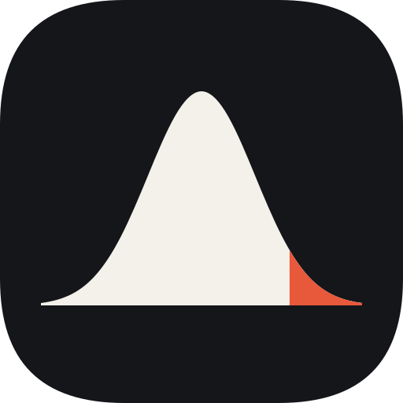
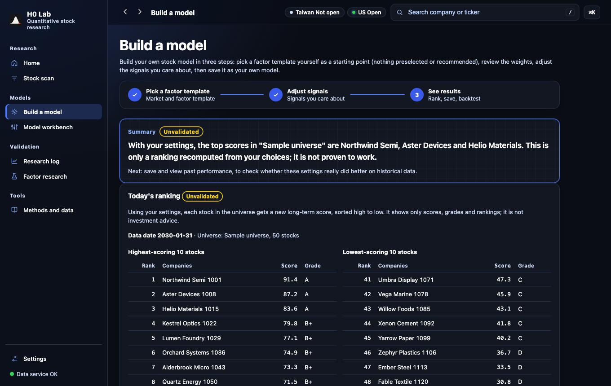

<p align="center">
  
</p>

<h1 align="center">H0 Lab</h1>

<p align="center"><b>Test your own stock models. Assume they don't work until the data says otherwise.</b></p>

<p align="center">H0 (H-zero) = the null hypothesis.</p>

<p align="center">
  <a href="https://github.com/JWcod/h0-lab/releases/latest"></a>
</p>

<p align="center"><b>English</b> · <a href="README.zh-TW.md">繁體中文</a></p>

<p align="center">
  <a href="https://github.com/JWcod/h0-lab/releases/latest/download/H0-Lab-macOS.dmg"></a>
</p>

<p align="center"></p>
<p align="center"><sub>All names and numbers in this screenshot are fictional.</sub></p>

## What You Get

- **Build your own model.** Start from an editable template in a step-by-step wizard, or set weights, thresholds, and custom expressions in the workbench.
- **Honest validation.** Every backtest shows how many settings you tried and compares your model with the example model and a random control. If the 95% interval contains zero, it says "not proven".
- **A holdout you can only open once.** Each model family gets one look at the most recent period, and that look is recorded.
- **Backtests without look-ahead.** Point-in-time data and tamper tests that catch future data leaking in. The one-click research data uses today's 40 largest companies per market, which carries survivorship bias, and the app says so. Universes with delisted Taiwan stocks need the full dataset, which that setup does not build.
- **Company research pages.** Financials, technicals, institutional flows, analyst expectations, news, and filings for Taiwan and US stocks, with every metric explained.
- **A valuation calculator.** DCF and other methods, with assumptions you adjust yourself.
- **Runs on your Mac.** Free public data, no account, no telemetry. Interface in English and Traditional Chinese.

## Quick Start

The app needs a Mac with Apple Silicon (M1 or later).

1. **Download** [H0-Lab-macOS.dmg](https://github.com/JWcod/h0-lab/releases/latest/download/H0-Lab-macOS.dmg), open it, and drag H0 Lab into Applications.
2. **Open H0 Lab.** It starts on your Mac and opens the home page in your browser. Look up a first company, which takes about a minute.
3. **Build research data once, then make a model.** Follow the setup card on the home page. It downloads about 40 large companies per market from free sources (about 520 requests, 30 to 40 minutes in total). Then open the model wizard.

<details>
<summary><b>First launch on macOS: "the developer cannot be verified"</b></summary>

The app is not notarized by Apple, so macOS may block it the first time. If you trust the download:

1. Open H0 Lab once, then close the warning.
2. Open **System Settings → Privacy & Security**.
3. Scroll down, click **Open Anyway** next to H0 Lab, and confirm.

You only need to do this once.

</details>

## Research Record

Before letting anyone build models, the project tested its own example model with the same rules. **All 11 pre-registered hypotheses for improving it were not proven to work.**

- Five were merged as corrections or simplifications. Those only had to be "not worse", so they make the numbers more correct, not more predictive. The other six were rejected.
- The first version reported a 12-month hit rate of 58.8%. On a universe chosen with only the information available at the time, from 2016 on, it fell to 54.4%. On 2016 to 2020, a period the rules were not tuned on, it was 51.1%.
- In the final holdout evaluation (judgment dates from 2024-10-01), every 95% interval on the main metrics contains zero.
- One idea found by looking at the development data (dropping momentum from the Taiwan short-term score: IC +0.056, interval +0.024 to +0.087) was tested on the holdout and did not reproduce: −0.029, interval −0.229 to +0.171.
- A pure-noise control sent through the merge gate passed 0 times out of 123.

The holdout period has been looked at several times, so it is not perfectly clean. The only clean evidence is the forward record that started on 2026-10-22, and it is still too small to read. Full record, in Traditional Chinese: [final report](docs/升級報告.md), [pre-registration](docs/預先登記.md), [holdout log](docs/holdout%20評估日誌.md).

## Data and Privacy

H0 Lab does not include or redistribute market data. Your Mac downloads it directly from free public sources (Yahoo Finance, FinMind, SEC EDGAR, TWSE, TPEx, TDCC, Google News), and you are responsible for following their terms. Your watchlists, notes, and models stay on your Mac (`~/Library/Application Support/H0 Lab/` for the app, the project folder for source installs) and are never uploaded. The symbols you look up do reach the data sources. The local site listens on `127.0.0.1` only. Every outgoing connection is listed in [DATA_SOURCES.md](DATA_SOURCES.md).

<details>
<summary><b>For Developers</b></summary>

### Run from source

Requires macOS and [Python 3.13 or newer](https://www.python.org/downloads/). Download the repository and double-click `H0 Lab.command`, or use the terminal:

```bash
./install.sh
```

```bash
./start.sh
```

The installer only touches the project folder. Then open `http://127.0.0.1:8765`. To build research data from the terminal:

```bash
.venv/bin/python scripts/setup_research.py
```

Optional settings go in `.env` (see `.env.example`):

| Variable | Meaning |
|---|---|
| `SEC_USER_AGENT` | Your name and contact email, as SEC requires. Without it the app does not contact the SEC, so US filings are missing |
| `FINMIND_TOKEN` | Free FinMind token for a higher quota |
| `INVEST_LAB_PORT` | Port, default 8765. The host always stays `127.0.0.1` |

### Tests

```bash
.venv/bin/python -m pip install "ruff==0.15.22" "pytest==9.2.0"
```

```bash
.venv/bin/ruff check .
```

```bash
INVEST_LAB_OFFLINE=1 .venv/bin/python -m pytest -q
```

Tests that need frozen data skip themselves, because the repository has no market data.

### How it is built

Python (FastAPI) and plain JavaScript with no build step. Python computes every number. No language model does arithmetic or produces a score. Research documents are in [docs/](docs/README.md), mostly in Traditional Chinese. Much of the project was developed with an AI coding assistant (Claude), checked by independent verification runs and the statistical gates described above.

### Contributing

Fork the repository and open a pull request. The maintainer reviews every pull request and decides whether to merge it. See [CONTRIBUTING.md](CONTRIBUTING.md). Report security problems privately as described in [SECURITY.md](SECURITY.md).

</details>

## License

The code is under the [Apache License 2.0](LICENSE). Third-party software is listed in [THIRD_PARTY_LICENSES.md](THIRD_PARTY_LICENSES.md). The license does not cover third-party data, and the "H0 Lab" name and icon are not provided under it. If you distribute a fork, please give it a different name and icon.

## Disclaimer

For research and education only. Not investment advice, and not a recommendation to buy or sell any security. Scores come from models you build, and the bundled templates are only starting points. Data may be wrong, and past or simulated results do not predict future results. H0 Lab does not connect to any broker and cannot place orders. Full text: [DISCLAIMER.md](DISCLAIMER.md).
