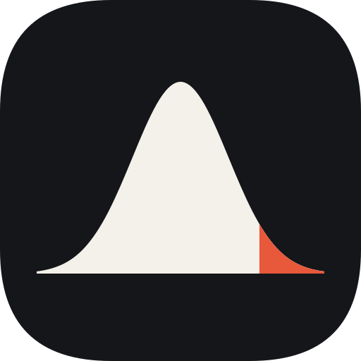
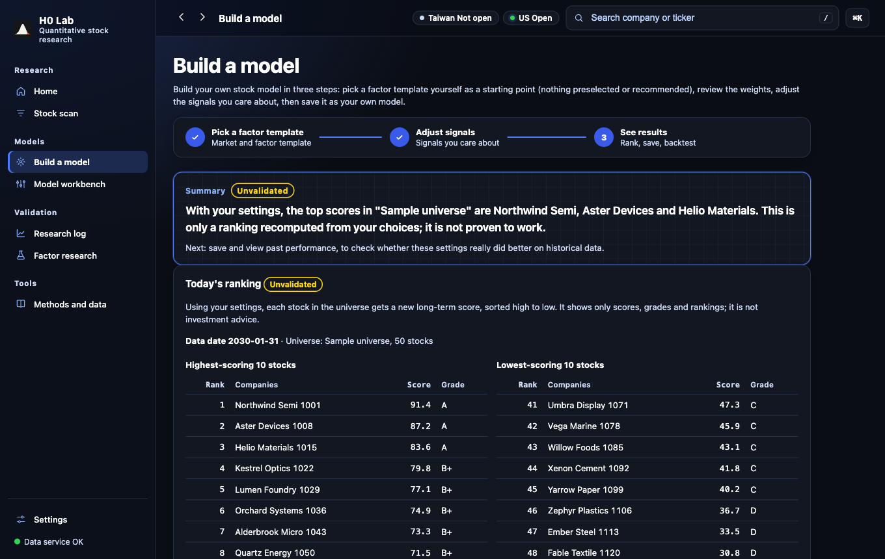

<p align="center">
  
</p>

<h1 align="center">H0 Lab</h1>

<p align="center"><b>Test your own stock models. Assume they don't work until the data says otherwise.</b><br>
自己建選股模型、自己驗證。在資料證明之前,先假設它沒用。</p>

<p align="center">H0(H-zero)= 虛無假設。</p>

<p align="center">
  <a href="https://github.com/JWcod/h0-lab/releases/latest"></a>
</p>

<p align="center"><a href="README.md">English</a> · <b>繁體中文</b></p>

<p align="center">
  <a href="https://github.com/JWcod/h0-lab/releases/latest/download/H0-Lab-macOS.dmg"></a>
</p>

<p align="center"></p>
<p align="center"><sub>截圖裡的公司名稱與數字都是虛構的。</sub></p>

## 你會得到什麼

- **建立自己的模型。** 用精靈從可修改的範本一步步開始,或在模型工作台設定權重、門檻與自訂運算式。
- **誠實驗證。** 每次回測都顯示你試了幾個設定,並和範例模型、隨機對照組比較。95% 區間含 0 就標「沒有證實有效」。
- **只能打開一次的樣本外測試期。** 每個模型家族只能看一次最近一段期間,而且會被記錄。
- **不偷看未來的回測。** 時點正確的資料,竄改測試會抓出混進來的未來資料。一鍵建立的研究資料用今天每個市場最大的 40 家公司,有存活者偏誤,App 裡也會註明;含下市台股的股票池要完整資料,一鍵設定不會建。
- **公司研究頁。** 台股與美股的財報、技術面、籌碼、分析師預期、新聞與公告,每個指標都有說明。
- **估值計算機。** DCF 等方法,假設由你自己調整。
- **在你的 Mac 上執行。** 免費公開資料、不用帳號、沒有遙測。介面有繁體中文與英文。

## 快速開始

App 需要 Apple Silicon 的 Mac(M1 或更新)。

1. **下載** [H0-Lab-macOS.dmg](https://github.com/JWcod/h0-lab/releases/latest/download/H0-Lab-macOS.dmg),打開後把 H0 Lab 拖到「應用程式」。
2. **打開 H0 Lab。** 它在你的 Mac 上啟動,並用瀏覽器打開首頁。先查第一家公司,約 1 分鐘。
3. **建立一次研究資料,再做模型。** 照首頁的引導卡做:從免費來源下載台股、美股各約 40 家大型公司(約 520 次請求,總共約 30 到 40 分鐘)。完成後打開模型精靈。

<details>
<summary><b>第一次在 macOS 開啟:「無法確認開發者」</b></summary>

App 沒有經過 Apple 公證,第一次打開時 macOS 可能會擋。如果你信任這個下載:

1. 先打開 H0 Lab 一次,再關掉警告。
2. 打開「**系統設定 → 隱私權與安全性**」。
3. 往下捲,在 H0 Lab 旁按「**強制打開**」並確認。

只需要做一次。

</details>

## 研究紀錄

開放大家建模型之前,本專案先用同一套規則檢驗自己的範例模型。**11 個預先登記的改良假設,全部沒有證實有效。**

- 5 個以修正或簡化合併,只需要證明「不更差」,所以它們讓數字算得更正確,不是更準;另外 6 個不採用。
- 第一版宣稱 12 個月命中率 58.8%。改用只靠當時資訊選出的股票池、2016 年起的資料後是 54.4%;在規則設計時沒看過的 2016 到 2020 年只有 51.1%。
- 最終樣本外測試(判斷日 2024-10-01 起),主要指標的 95% 區間全部含 0。
- 一個看過開發資料才發現的想法(台股短期分數拿掉動能:IC +0.056,區間 +0.024 到 +0.087),拿到樣本外測試期檢驗沒有重現:−0.029,區間 −0.229 到 +0.171。
- 純雜訊對照組送進合併閘門,123 次通過 0 次。

樣本外測試期已經被看過好幾次,不是完全乾淨;唯一乾淨的證據是 2026-10-22 開始的前瞻紀錄,目前樣本還太少。完整紀錄:[總結報告](docs/升級報告.md)、[預先登記](docs/預先登記.md)、[樣本外測試紀錄](docs/holdout%20評估日誌.md)。

## 資料與隱私

H0 Lab 不附帶也不散布市場資料。資料由你的 Mac 直接向免費公開來源下載(Yahoo Finance、FinMind、SEC EDGAR、證交所、櫃買中心、集保、Google News),遵守各來源條款是你自己的責任。觀察清單、筆記與模型都留在你的 Mac(App 在 `~/Library/Application Support/H0 Lab/`,原始碼安裝在專案資料夾),不會上傳;你查的股票代號則會送到資料來源。本機網站只監聽 `127.0.0.1`。所有對外連線列在 [DATA_SOURCES.md](DATA_SOURCES.md)。

<details>
<summary><b>給開發者</b></summary>

### 從原始碼執行

需要 macOS 與 [Python 3.13 以上](https://www.python.org/downloads/)。下載本 repo 後在 Finder 雙擊 `H0 Lab.command`,或用終端機:

```bash
./install.sh
```

```bash
./start.sh
```

安裝程式只動專案資料夾。接著打開 `http://127.0.0.1:8765`。用終端機建立研究資料:

```bash
.venv/bin/python scripts/setup_research.py
```

選填設定放在 `.env`(見 `.env.example`):

| 變數 | 意思 |
|---|---|
| `SEC_USER_AGENT` | 你的名稱與聯絡信箱(SEC 要求) |
| `FINMIND_TOKEN` | 免費的 FinMind token,額度較高 |
| `INVEST_LAB_PORT` | 埠號,預設 8765;主機一律是 `127.0.0.1` |

### 測試

```bash
.venv/bin/python -m pip install "ruff==0.15.22" "pytest==9.2.0"
```

```bash
.venv/bin/ruff check .
```

```bash
INVEST_LAB_OFFLINE=1 .venv/bin/python -m pytest -q
```

repo 不含市場資料,需要凍結資料的測試會自動 skip。

### 怎麼做的

Python(FastAPI)加純 JavaScript,沒有建置步驟。數字一律由 Python 計算,語言模型不算數、不產生分數。研究文件在 [docs/](docs/README.md),大多是繁體中文。本專案大部分由 AI 開發助理(Claude)協助開發,並經過獨立驗證與上述的統計閘門。

### 參與開發

Fork 本 repo 後開 PR。每個 PR 由維護者審查並決定是否合併,詳見 [CONTRIBUTING.md](CONTRIBUTING.md)。安全問題請依 [SECURITY.md](SECURITY.md) 私下回報。

</details>

## 授權

程式碼依 [Apache License 2.0](LICENSE) 授權,第三方軟體見 [THIRD_PARTY_LICENSES.md](THIRD_PARTY_LICENSES.md)。授權不涵蓋第三方資料,「H0 Lab」名稱與圖示也不隨授權提供;發布 fork 時請改用其他名稱與圖示。

## 免責聲明

僅供研究與教育,不構成投資建議,也不是買賣任何證券的建議。分數來自你建立的模型,內附範本只是起點。資料可能有誤,過去或模擬結果不代表未來。H0 Lab 不連接任何券商,也無法下單。全文見 [DISCLAIMER.md](DISCLAIMER.md)。
